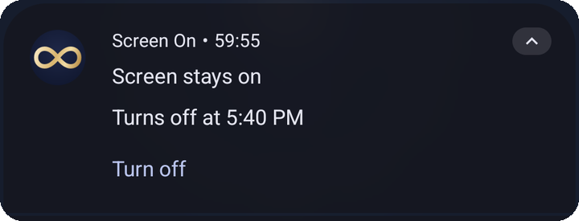

# Screen On

Keep your Android screen awake for as long as you need, from the app or a Quick Settings tile. When it turns off, whether you turn it off, the timer ends, the battery runs low, or the phone restarts, your own screen timeout comes back exactly as it was.

  
  &nbsp;
  
  &nbsp;
  

## Features

- **Tap the dial.** One tap keeps the screen on and another lets it sleep again. While it's on, the gold ticks around the dial show the time remaining.
- **Auto-off timer.** Under **Keep on for**, pick 15 min, 30 min, 1 hr, 2 hr, or ∞ (until you turn it off). The app shows when it will turn off, for example *"Until 5:18 PM, then back to 30 seconds"*. Picking a different length while it's on restarts the timer from now.
- **Always visible.** In both modes a quiet notification shows that the screen is being kept on, counts down to when it turns off, and has a **Turn off** button.
- **Still-on reminder.** With ∞ picked, a reminder comes every 2 hours so a forgotten session doesn't drain your battery. It rides on the app's existing alarm, so it never wakes the phone. You can mute it under *Still-on reminders* in the app's notification settings.
- **Turn off on low battery.** On by default. It turns itself off at 15% unless the phone is charging.
- **Restarts are handled.** A restart always counts as off, and your own timeout is restored as soon as the phone starts. This also works on phones that block apps from starting at boot.
- **Your timeout, untouched.** Screen On saves the exact timeout you had and puts it back. If you change the timeout yourself while it's on, it keeps your new choice.
- **Light and dark themes**, and very low battery and memory use. Nothing wakes the phone while the screen is off.

## Two ways to stay awake

| Method | How it works | Background cost |
|---|---|---|
| **Timeout** | Raises the system screen timeout to its maximum, then puts your own timeout back when it turns off. | None. Nothing runs. |
| **Wake lock** | A tiny foreground service holds the screen awake and leaves your timeout alone. It releases the lock whenever the screen is off. | A small service while on |

  

### Permissions

- **Modify system settings** (Timeout mode). The app opens the right settings screen the first time you use it.
- **Alarms & reminders** (optional, Android 12+). This lets the timer end on the minute in Timeout mode. If it's missing, an **Allow exact timing** link appears and the timer may end a few minutes late. Wake lock mode doesn't need it.
- **Notifications** (optional, Android 13+). Asked once, the first time you turn it on. Used for the status notification and the still-on reminder. Both modes work without it.

## Quick Settings tile

  

**Android 13 and newer:** tap **Add to Quick Settings** at the bottom of the app and confirm.

**Any version:**

1. Swipe down twice from the top of the screen to open Quick Settings.
2. Tap the **pencil** (edit) icon.
3. Find **Keep screen on** (the ∞ icon) and drag it into your tiles.
4. Tap **Done**.

Tap the tile to turn it on or off using the method and timer chosen in the app. While a timer is running, the tile shows when it ends. Long-press it to open the app.

## Download

Get the latest APK from [Releases](../../releases). Requires Android 7.0 or newer.

## Building

Open the project in Android Studio, or run `./gradlew assembleDebug`.

Development happens on `main`. Every push to `production` is tested and built by GitHub Actions. When `versionName` in `app/build.gradle.kts` is new, a signed APK is published as a GitHub release, with notes from `.github/release-notes/v<version>.md`. See [`.github/workflows/release.yml`](.github/workflows/release.yml).

Graphics and text for a Google Play listing are in [`docs/play-store`](docs/play-store).
