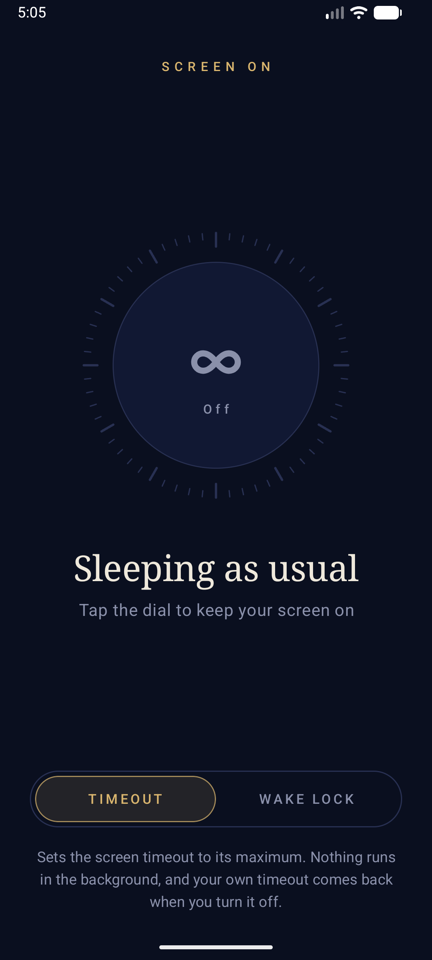
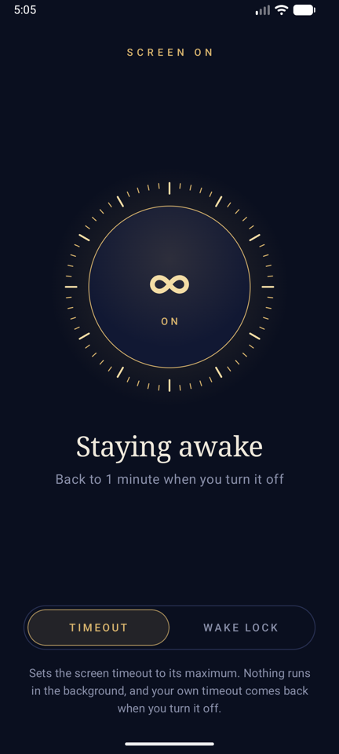
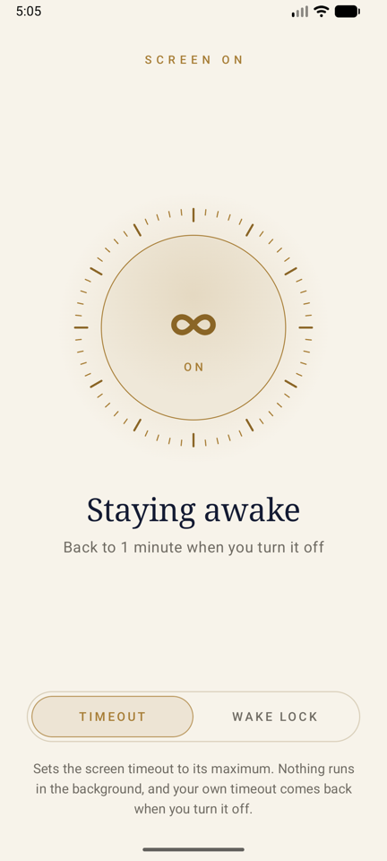
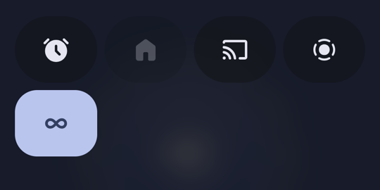

# Screen On

Keep your Android screen awake for as long as you want — from the app or a Quick Settings tile — and get your own screen timeout back exactly as it was when you turn it off.

  
  &nbsp;
  
  &nbsp;
  

## Two ways to stay awake

| Method | How it works | Background cost |
|---|---|---|
| **Timeout** | Raises the system screen timeout to its maximum. Your previous timeout is saved and restored when you turn it off. If you change the timeout yourself while it's on, your new value is kept. | None, nothing runs |
| **Wake lock** | A tiny foreground service holds the screen awake and leaves your timeout untouched. It releases the lock whenever the screen is off. | A small service while on |

Timeout mode needs the **Modify system settings** permission. The app opens the right settings screen the first time you use it.

## Quick Settings tile

  

**Android 13 and newer:** tap **Add to Quick Settings** at the bottom of the app and confirm.

**Any version:**

1. Swipe down twice from the top of the screen to open Quick Settings.
2. Tap the **pencil** (edit) icon.
3. Find **Keep screen on** (the ∞ icon) and drag it into your tiles.
4. Tap **Done**.

Tap the tile to turn it on or off using the method selected in the app. Long-press it to open the app.

## Download

Get the latest APK from [Releases](../../releases). Requires Android 7.0 or newer.

## Building

Open the project in Android Studio, or run `./gradlew assembleDebug`.

Every push to `main` is tested and built by GitHub Actions. When `versionName` in `app/build.gradle.kts` is new, a signed APK is published as a GitHub release. See [`.github/workflows/release.yml`](.github/workflows/release.yml).
