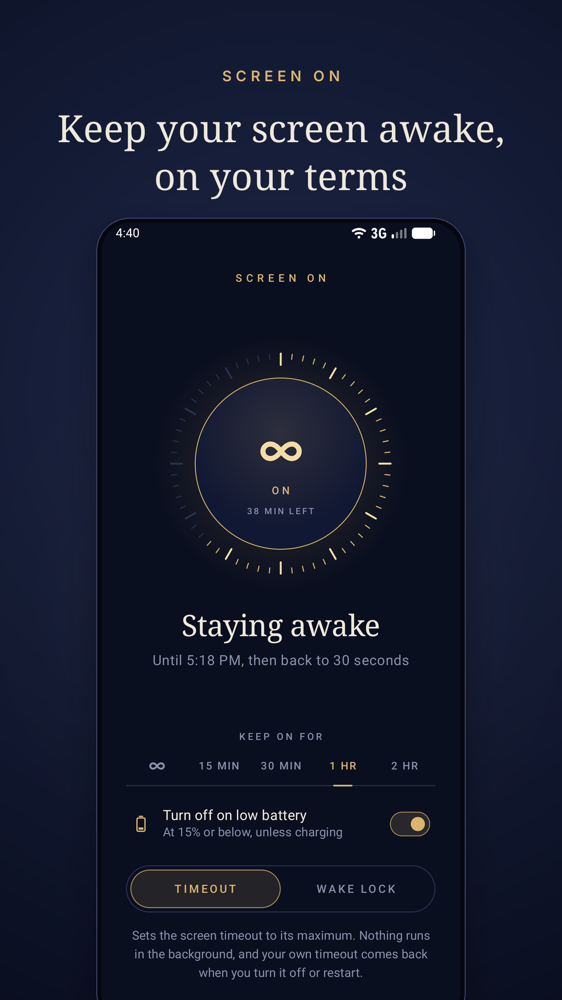
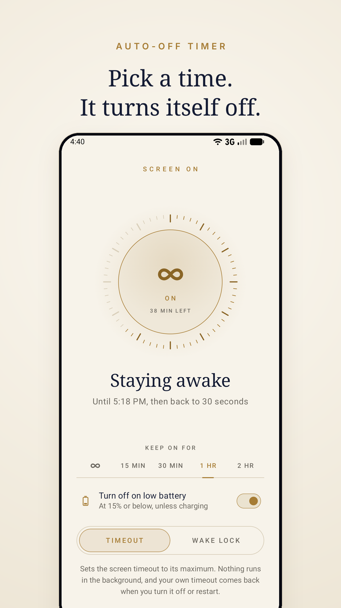
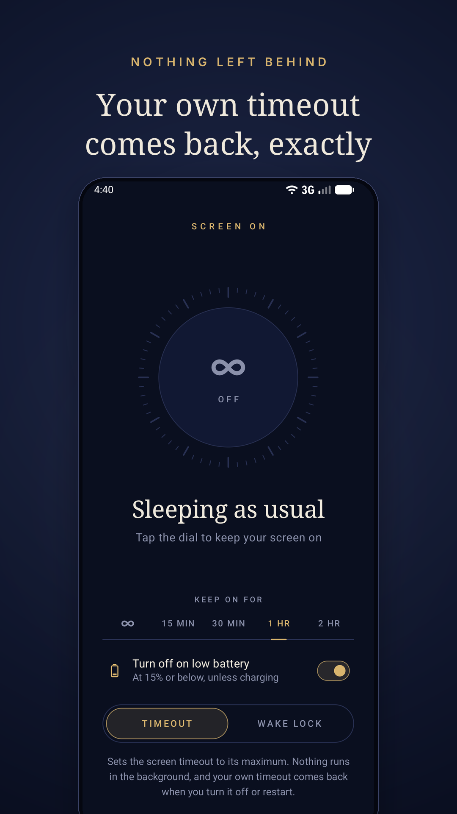
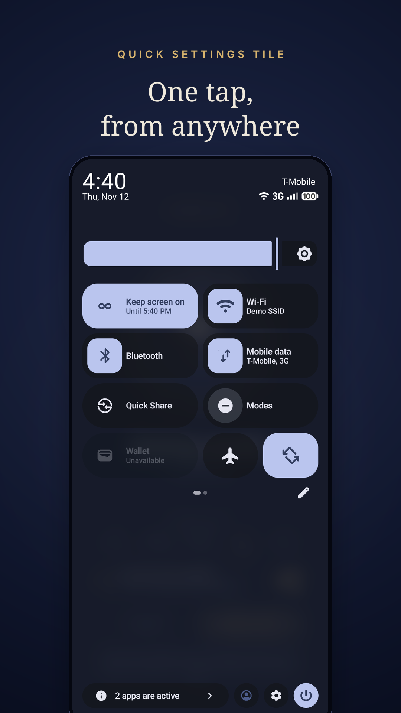
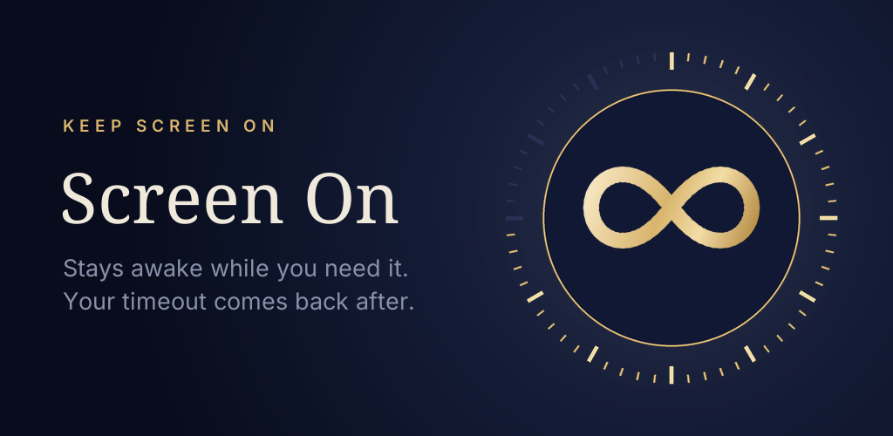

# Google Play listing

Everything here is ready to upload in the Play Console under **Grow users → Store presence → Main store listing**.

## Graphics

| File | Play Console field | Size |
|---|---|---|
| [`icon-512.png`](icon-512.png) | App icon | 512 × 512 PNG, full square (Play rounds the corners) |
| [`feature-graphic.png`](feature-graphic.png) | Feature graphic | 1024 × 500 PNG |
| [`screenshots/`](screenshots) | Phone screenshots | 1080 × 1920 PNG (9:16), in upload order |

  
  
  
  

The screenshots come from an Android 16 emulator in demo mode (clean status bar). The captions use Noto Serif and Inter, both under the SIL Open Font License, so they're safe to publish. If the UI changes, take new screenshots before uploading.

## Text

**App name** (30 characters max)

> Screen On: Keep Screen Awake

**Short description** (80 characters max)

> Keep your screen on with a timer, then get your own screen timeout back.

**Full description** (4,000 characters max)

> Screen On keeps your display awake for as long as you need: reading a recipe, following a map, presenting, or watching a long download. When you're done, your phone goes back to sleeping exactly as it did before.
>
> TAP THE DIAL
> One tap keeps the screen on and another lets it sleep again. Or use the Quick Settings tile without opening the app.
>
> AUTO-OFF TIMER
> Keep it on for 15 minutes, 30 minutes, 1 hour, 2 hours, or until you turn it off. The dial counts down and shows when it will turn off.
>
> YOUR TIMEOUT COMES BACK
> Screen On remembers the screen timeout you had and restores that exact value when it turns off, when the timer ends, or after a restart. If you change the timeout yourself while it's on, it keeps your choice.
>
> SAFE ON LOW BATTERY
> It turns itself off at 15% battery unless you're charging, so it never drains your phone.
>
> TWO WAYS TO STAY AWAKE
> • Timeout: raises the system screen timeout. Nothing runs in the background.
> • Wake lock: a tiny service holds the screen on and leaves your timeout alone. It pauses whenever the screen is off.
>
> LIGHT ON YOUR BATTERY
> Nothing wakes your phone while the screen is off. No ads, no tracking, no internet permission.
>
> Light and dark themes. Android 7.0 and newer.

## Before you submit

- **Category:** Tools. **Contains ads:** No.
- **Data safety:** the app collects and shares no data and has no internet permission.
- **Foreground service (special use):** Play asks for a declaration and a short video. Use the text from the manifest: *"Keeps the display awake at the user's request until they turn it off."*
- **Exact alarms:** the app asks for `SCHEDULE_EXACT_ALARM`, which the user grants. It does not use `USE_EXACT_ALARM`, so it doesn't need the alarm/calendar-app exception.
- **Modify system settings:** used only to change the screen timeout in Timeout mode. Say so in the review notes.
